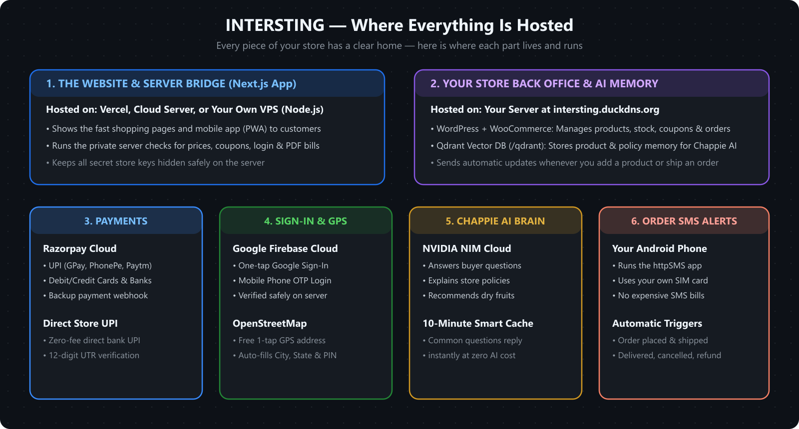
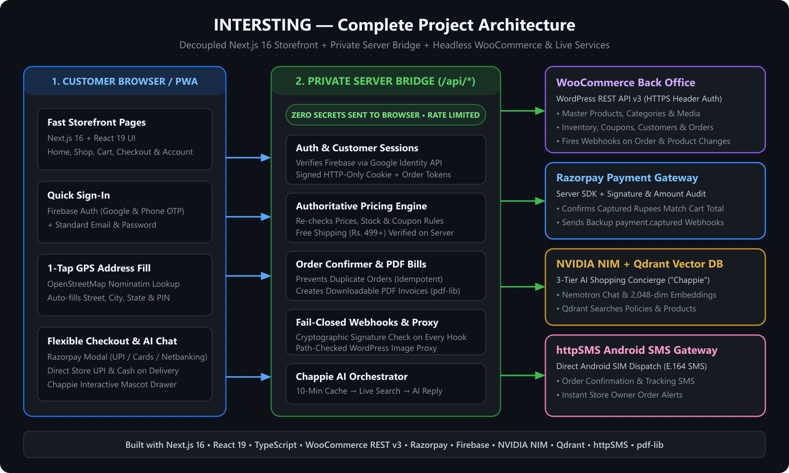
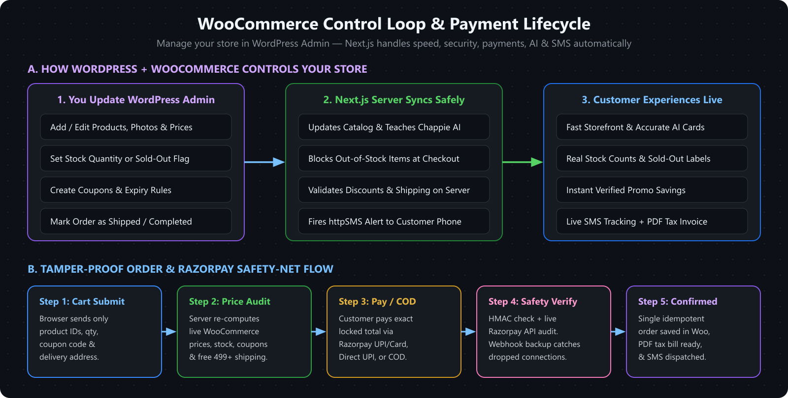

  

# 📘 INTERSTING — Store Owner Study Guide

> 💡 **Welcome!** This handbook is written like a simple Notion study guide. There is **no code** here—only clear, everyday explanations and visual diagrams so anyone can understand how the **INTERSTING** store works from start to finish.

---

## 1. The Big Idea: Two Halves Working Together

Think of your online store like a modern restaurant with a **Showroom** in the front and a **Kitchen** in the back:

- **Your Back Office (WordPress + WooCommerce):** This is your private kitchen and warehouse. Here, you add new dry fruits, change prices, upload product photos, track stock, create discount coupons, and manage customer orders.
- **Your Customer Website (The Fast Storefront):** This is the clean, modern showroom your customers open on their phone or laptop. It loads fast, works like an installable phone app, accepts online payments, and includes your AI helper **Chappie**.
- **The Private Bridge Between Them:** Whenever a shopper views products, signs in, or pays for an order, a private server bridge talks to WooCommerce behind the scenes—so your store passwords and payment secrets never reach the customer's screen.

---

## 2. Where Everything Is Hosted

> 📌 **Study Note:** Every part of the store has its own home on the internet. Knowing where each piece lives makes it easy to manage, update, or troubleshoot.

### Quick Home Map

- **Customer Website & Private Server:** Hosted on **Vercel** (or a Node.js cloud server / VPS). This serves the fast shopping pages and runs all private price, login, and invoice checks.
- **Store Back Office (WordPress + WooCommerce):** Hosted on your server at **intersting.duckdns.org**. This is where your master catalog, stock, coupons, and orders live.
- **Chappie AI Search Memory (Qdrant):** Hosted on your same server under the **Qdrant** service. It remembers your product details and store policies so Chappie can answer quickly.
- **Online Payments (Razorpay):** Hosted on **Razorpay Cloud**. Handles UPI apps (Google Pay, PhonePe, Paytm, CRED), debit/credit cards, and net banking.
- **Customer Sign-In (Google Firebase):** Hosted on **Google Firebase Cloud**. Powers quick Google Sign-In and mobile phone OTP login.
- **Chappie AI Brain (NVIDIA NIM):** Hosted on **NVIDIA's AI Cloud**. Generates friendly, natural answers to shopper questions.
- **Order SMS Alerts (httpSMS):** Runs on **your own Android phone** using your SIM card, sending order and delivery texts without expensive SMS gateway bills.
- **One-Tap Address Fill (OpenStreetMap):** Uses **OpenStreetMap's free public lookup** to turn GPS coordinates into a street address, city, state, and PIN code.

---

## 3. How the Whole Store Connects

> 💡 **How to Read This Picture:** Start on the left (**Customer Browser / Mobile App**), follow the arrows into the middle (**Private Server Bridge**), and see how the right side (**Store Tools**) responds safely.

### What Happens Behind the Scenes

1. **Customers never talk directly to your database.** Everything goes through the Private Server Bridge in the middle.
2. **Prices and discounts are always verified.** Even if someone tries to change a price in their browser, the server ignores it and checks the real price directly from WooCommerce.
3. **Every external tool has one clear job.** Razorpay handles money, Firebase handles quick login, NVIDIA + Qdrant power Chappie AI, and your Android phone sends SMS updates.

---

## 4. How You Control Everything From WordPress

> 📌 **Key Takeaway:** You never need to edit website code for daily store work. Your WordPress dashboard is the single boss of your business.

### What Updates Automatically When You Make a Change

- **Add or edit a product or sale price:** It shows up on the website automatically, and Chappie AI learns about the new product right away.
- **Mark an item Out of Stock:** The website shows it as unavailable and blocks anyone from checking out with it.
- **Create a discount coupon:** Minimum spend rules, expiry dates, percentage discounts, and flat discounts are automatically enforced at checkout.
- **Change an order status:** When you mark an order as Processing, Shipped, Completed, Cancelled, or Refunded, your Android phone automatically sends a clean SMS update to the customer.

---

## 5. Step-by-Step: What Happens When a Customer Buys

1. **Customer taps Pay Now:** They enter their address (or tap once for GPS autofill), apply a coupon if they have one, and choose how to pay.
2. **Server double-checks everything:** The private server asks WooCommerce for the real prices, stock availability, coupon eligibility, and the ₹499 free-shipping rule.
3. **Customer pays:**
   - **Razorpay Online:** The payment popup opens for the exact verified amount. Once paid, the server double-checks with Razorpay that the money was truly captured, then saves the order in WooCommerce.
   - **Direct Store UPI:** The customer pays your store UPI ID and enters their 12-digit transaction number. The order is saved as On-Hold for you to confirm.
   - **Cash on Delivery:** The order is saved immediately as Processing so you can pack and ship it.
4. **Backup safety net:** Even if a customer's internet disconnects right after paying on Razorpay, Razorpay sends a private confirmation signal directly to your server so the order is never lost.
5. **SMS & PDF Invoice:** Your Android phone texts the customer an order confirmation, and the customer can immediately view and download their PDF tax bill.

---

## 6. How Customer Accounts, Privacy & Chappie AI Work

> 🛡️ **Built-In Privacy:** Only the customer who placed an order—or someone holding the private checkout receipt link—can view full personal details or download the PDF tax bill.

- **Protected Login Sessions:** Whether a shopper signs in with Google, phone OTP, or email and password, their session is locked with a tamper-proof signature.
- **Safe Guest Tracking:** Anyone checking an order without signing in only sees basic city, state, and delivery status—never phone numbers or street addresses.
- **Chappie AI's 3-Step Cost Saver:**
  1. **Instant Cache:** If someone asks a common question that was already answered in the last 10 minutes, Chappie replies instantly with zero AI cost.
  2. **Smart Lookup:** For normal product or policy questions, Chappie reads live WooCommerce items and your policy memory, then makes one short AI call.
  3. **Deep Search:** For multi-part questions, Chappie searches step by step so customers always get an accurate answer.

---

## 7. Simple Launch Checklist for the Store Owner

> ✅ **Before Going Live:** Make sure these three simple items are in place.

1. **Keep Your WordPress Server Online:** Ensure your WordPress + WooCommerce server is running smoothly so products, login, and checkout stay live.
2. **Use Fresh Passwords & Hosting Keys:** Make sure your hosting dashboard (such as Vercel) has all updated WooCommerce, Razorpay, Firebase, AI, and SMS keys saved safely—and rotate any old WordPress application password you used during early setup.
3. **Note on the Contact Us Page:** The Contact Us form currently shows a confirmation message on the customer's screen and does not send emails automatically yet.
