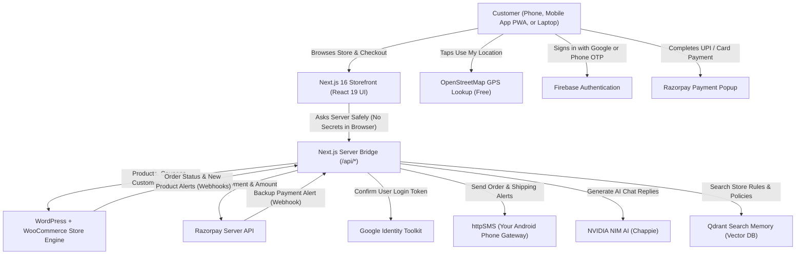
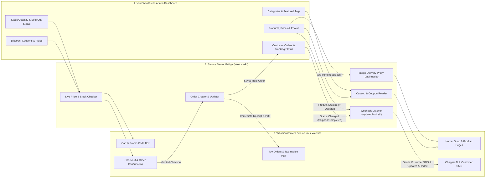
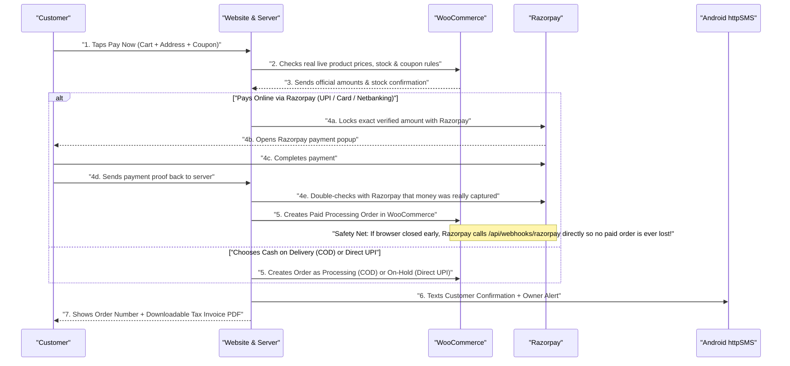
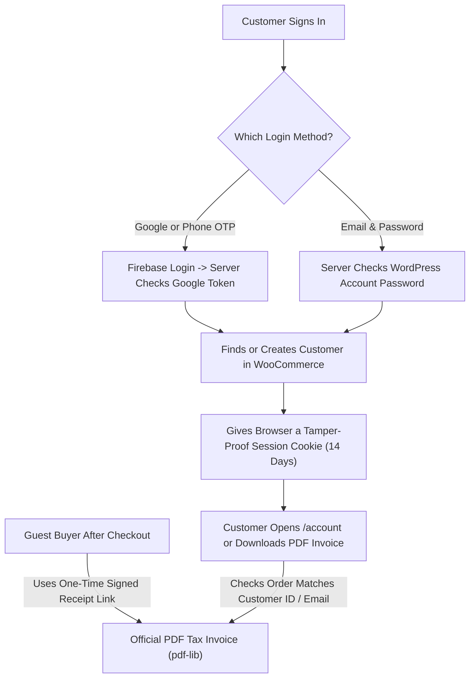
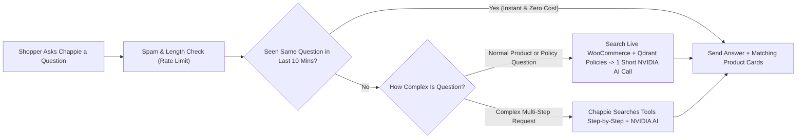

# INTERSTING Store — Simple Project & WooCommerce Architecture Guide

Welcome to the plain-English handbook for how the **INTERSTING** online store works. Whether you are managing products, deploying updates, or explaining the system to someone else, this guide shows **every piece of technology you are using**, **how WooCommerce connects to your website**, and **what happens behind the scenes**.

---

## 1. The Big Idea: What Is "Headless WooCommerce"?

Think of a normal shop vs. a modern restaurant setup:
- **WordPress + WooCommerce (The Kitchen & Warehouse):** This is your private back office (`intersting.duckdns.org/wp-admin`). You add products, change prices, upload photos, update stock counts, create coupons, and manage customer orders here. Customers never see the slow WordPress theme.
- **Next.js + React (The Fast Customer Showroom):** This is the website your shoppers actually open on their phone or laptop. It looks super clean, loads fast, works like a mobile app (PWA), lets users pay with Razorpay/UPI/COD, and chats with your AI assistant (**Chappie**).
- **The Bridge Between Them (Next.js API Layer):** Whenever a customer views products, logs in, or places an order, your Next.js server talks privately to WooCommerce behind the scenes—so your secret passwords and keys **never reach the customer's browser**.

---

## 2. Overall Project Architecture (How Everything Connects)

---

## 3. WooCommerce Architecture (How WordPress Controls Your Site)

Your storefront does **not** keep a separate copy of your catalog or order database. WordPress + WooCommerce is the **single boss** for your business data:

### What happens automatically when you change something in WordPress:
1. **Add or edit a product / sale price:** It appears automatically on `/shop` and `/product/[slug]`, and WooCommerce sends a webhook to `/api/webhooks/product` so Chappie AI learns about the new product.
2. **Mark an item Out of Stock:** Checkout blocks anyone from buying it, and the storefront shows it as unavailable.
3. **Create a coupon (minimum spend, expiry, free shipping, percent/flat off):** Our server pricing checker (`lib/payment/pricing.ts`) enforces every WooCommerce coupon rule automatically at checkout.
4. **Update an order status (`Processing`, `Shipped`, `Completed`, `Cancelled`, `Refunded`):** WooCommerce notifies `/api/webhooks/woocommerce/orders`, which sends an automatic WhatsApp-style SMS update to the buyer via your Android phone (`httpSMS`).

---

## 4. What Happens When a Customer Places an Order

This diagram shows why payments and orders are rock-solid—even if a customer loses internet or closes their browser right after paying:

---

## 5. How Customer Login & Invoices Work Safely

---

## 6. How Your AI Shopping Assistant ("Chappie") Works

Chappie uses a **3-step speed & cost-saving design** so common questions don't waste AI credits:

---

## 7. Everything You Are Using (Complete Plain-English Tech Stack)

| What You Are Using | Version / Tool | What It Actually Does for Your Store |
| --- | --- | --- |
| **Next.js (App Router + Turbopack)** | `16.3.4` | Powers all website pages AND acts as your secure private backend API (`app/api/*`). |
| **React & React DOM** | `19.2.8` | Runs interactive shopping features like cart drawer, checkout steps, account tabs, and chat. |
| **TypeScript** | `^5` | Catches spelling mistakes and data bugs before code goes live. |
| **TanStack React Query** | `^5.102.8` | Keeps product lists smooth and avoids refetching data unnecessarily. |
| **WordPress + WooCommerce REST API v3** | `intersting.duckdns.org` | Stores every product, category, image, stock count, coupon, customer, and order. |
| **Razorpay** | `razorpay` `^2.9.8` | Accepts UPI apps (GPay/PhonePe/Paytm), Cards, and Netbanking, with backup webhook verification. |
| **Direct UPI & Cash on Delivery** | Built into `/api/orders` | Lets buyers pay on delivery (`cod`) or scan your store UPI ID directly (`bacs`). |
| **Firebase Authentication** | `firebase` `^13.2.0` | Gives customers fast Google Sign-In and Phone OTP login, verified server-side. |
| **httpSMS** | Android SMS API | Turns your Android phone SIM into an automatic SMS notification sender for order confirmations and shipping updates. |
| **NVIDIA NIM AI (`openai` SDK)** | `openai` `^7.57.0` | Powers Chappie's smart shopping answers (`nvidia/nemotron-3.5-bolt-e4b`) and search meaning (`nvidia/nemotron-3.5-embed-1b`). |
| **Qdrant Vector Database** | Hosted at `/qdrant` | Stores searchable knowledge from your policy pages (`content/policies/*.json`) and products for Chappie. |
| **`pdf-lib`** | `^1.17.1` | Draws clean downloadable GST/Tax PDF invoices right on your server (`lib/utils/invoicePdf.ts`). |
| **OpenStreetMap Nominatim** | Free Public API | Fills city, state, and pincode automatically when shoppers tap **Use My Location** on checkout (no API key needed). |
| **`lucide-react`** | `^1.41.0` | Crisp icons used across menus, buttons, cart, and order tracking. |
| **`page-mascot`** | `^0.1.0` | Drives the floating interactive **Chappie** character in the corner (`public/mascots/`). |
| **PWA (`sw.js` + `manifest.json`) & `sharp`** | Offline scripts + Service Worker | Lets customers install the site like an app while blocking caching of private pages (`/account`, `/checkout`, `/invoice`, `/login`, `/cart`). `sharp` optimizes images & app icons locally. |

---

## 8. Simple Folder Map (Where Things Live)

| Folder | What Is Inside |
| --- | --- |
| `app/` | Every visible website page (`/`, `/shop`, `/product/[slug]`, `/cart`, `/checkout`, `/wishlist`, `/account`, `/invoice/[id]`, legal pages) plus all private server APIs inside `app/api/`. |
| `components/` | Reusable UI blocks: header, footer, product cards, category grids, checkout summaries, PWA install prompt, and Chappie AI drawer. |
| `lib/` | Behind-the-scenes brains: WooCommerce connection, server pricing & coupon calculator, Razorpay verification, login cookie signer, httpSMS sender, PDF invoice builder, and Chappie AI engine. |
| `store/`, `hooks/`, `providers/` | Remembers cart items, wishlist items, logged-in user, dark/light theme, and popup alerts across pages. |
| `content/policies/` | Your master text files (`faq.json`, `shipping.json`, `returns.json`, `contact.json`, `terms-privacy.json`) used by both policy pages and Chappie AI. |
| `scripts/` | Helper scripts to optimize product photos, build round app icons, seed products, and sync policies/products into Qdrant. |
| `public/` | App icons, brand logo, Chappie mascot images, `manifest.json`, and PWA Service Worker (`sw.js`). |

---

## 9. Important Safety Rules & Launch Checklist

### Built-In Protections Already Active in Code
- **Real Prices Checked on Server:** Hackers cannot edit browser prices or fake coupons—the server recalculates item prices, stock, coupon discounts, and ₹499 free-shipping threshold from WooCommerce (`lib/payment/pricing.ts`).
- **Private Invoices & Orders:** Customers can only download tax invoices if logged into the matching account or using the signed one-time link from checkout. Guest order lookup requires a full 10-digit phone or non-placeholder email match.
- **No Leaked Keys in Browser:** WooCommerce, Razorpay secret, NVIDIA, and httpSMS keys stay strictly on the server (and WooCommerce credentials are sent only inside encrypted HTTPS headers, never inside URLs).
- **Verified Webhooks:** Incoming Razorpay and WooCommerce webhooks must carry valid cryptographic signatures (`500`/`401` otherwise).

### Your 3-Step Checklist Before Going Live
1. **Rotate Your Old WordPress App Password:** Earlier code in `scripts/seed-woocommerce.js` exposed an old WordPress Application Password in git history. Create a new one in **WordPress Admin -> Users -> Profile -> Application Passwords** and update `WC_APP_PASSWORD` in `.env.local` and your hosting environment.
2. **Copy All Secrets Into Vercel (Before Building):** Ensure `SESSION_SECRET`, all 7 `NEXT_PUBLIC_FIREBASE_*` keys, `WC_CONSUMER_KEY`, `WC_CONSUMER_SECRET`, `WC_WEBHOOK_SECRET`, `NEXT_PUBLIC_RAZORPAY_KEY_ID`, `RAZORPAY_KEY_SECRET`, `RAZORPAY_WEBHOOK_SECRET` (if separate), `NEXT_PUBLIC_STORE_UPI_*`, `HTTPSMS_*`, `NVIDIA_*`, and `QDRANT_*` are added in Vercel Project Settings.
3. **Keep Your WordPress Server Online & Note Contact Form:** Make sure `intersting.duckdns.org` is running so live catalog, login, and checkout work; also note that the contact form (`app/contact/page.tsx`) currently shows a browser confirmation only and does not email messages yet.
