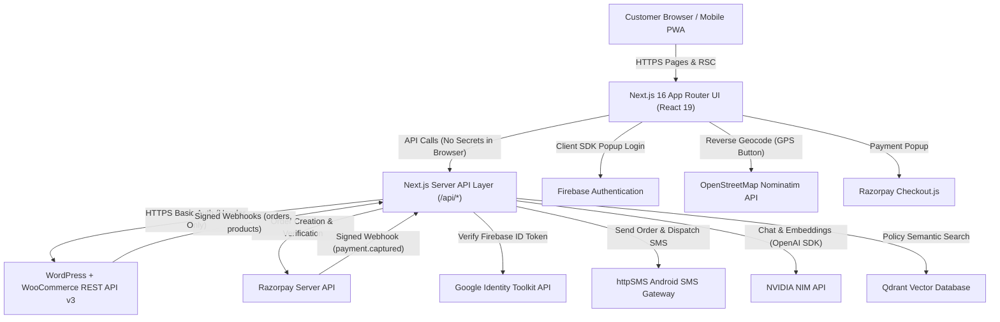
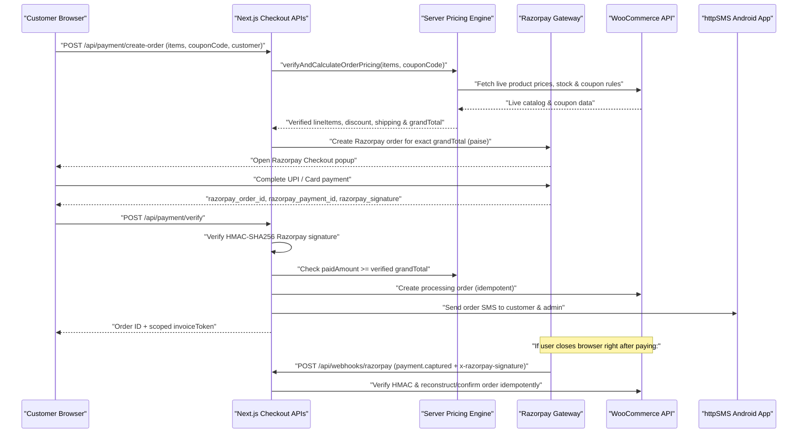
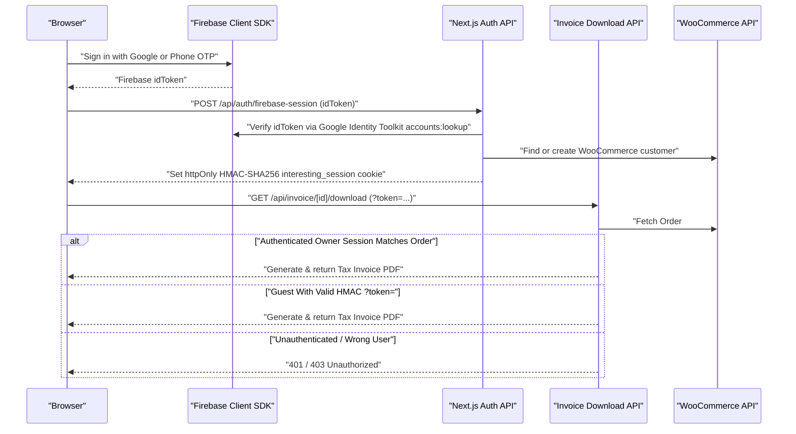
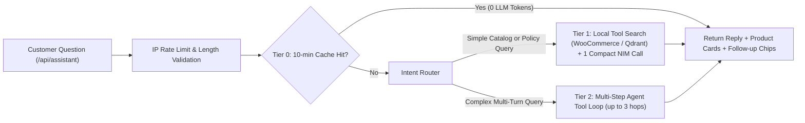

# Intersting Store — Complete Project & Architecture Guide

This guide explains **what technologies, packages, APIs, and services** this project uses, **how everything connects together**, and **what security & code quality improvements were implemented**.

---

## 1. High-Level System Architecture

Your website uses a **Headless E-Commerce Architecture**:
- **Frontend & API Gateway (`Next.js 16` + `React 19`)** renders the fast storefront UI, handles cart/checkout/account/PWA behavior, and acts as a **secure server-side proxy** (`app/api/*`) so secret keys never touch the browser.
- **Store & Inventory Backend (`WordPress + WooCommerce REST API v3`)** at `intersting.duckdns.org` remains your single source of truth for products, categories, prices, stock, coupons, customers, and orders.
- **External Integrations** power online payments (**Razorpay**), social sign-in (**Firebase Auth / Google OAuth**), order SMS alerts (**httpSMS Android Gateway**), AI shopping assistance (**NVIDIA NIM + Qdrant Vector DB**), and checkout GPS autofill (**OpenStreetMap Nominatim**).

---

## 2. What Technologies You Are Using (Complete Breakdown)

### A. Core Frontend & Build Stack
| Technology | Version / Location | What It Does & Why It Is Used Here |
| --- | --- | --- |
| **Next.js (App Router + Turbopack)** | `16.3.4` (`package.json`) | Runs both the storefront pages (`app/**/page.tsx`) and the secure backend API routes (`app/api/**/route.ts`) in one unified project. |
| **React & React DOM** | `19.2.8` | Drives interactive components, hooks, context providers, and client state. |
| **TypeScript** | `^5` (`tsconfig.json`) | Enforces type safety across WooCommerce payloads, payment structures, API responses, and UI props. |
| **CSS Modules** | `*.module.css` | Scoped per-component styling without CSS class collisions. |
| **Lucide React** | `^1.41.0` | Crisp SVG icon library used across navigation, account dashboards, checkout, and policy pages. |
| **TanStack React Query** | `^5.102.8` (`providers/QueryProvider.tsx`) | Manages client-side data fetching, caching, and background synchronization (via `hooks/useProducts.ts`). |
| **page-mascot** | `^0.1.0` (`components/chat/AiAssistant.tsx`) | Powers the interactive cursor-tracking **Chappie** mascot widget (`public/mascots/toaster-*.webp`). |

### B. E-Commerce Backend & Media Delivery
| Component | Files | How It Works |
| --- | --- | --- |
| **WooCommerce REST API v3** | `lib/api/client.ts`, `products.ts`, `orders.ts`, `customers.ts`, `reviews.ts` | Fetches products, categories, coupons, reviews, customer profiles, and writes orders on `NEXT_PUBLIC_WC_URL`. Server requests send `WC_CONSUMER_KEY` and `WC_CONSUMER_SECRET` (or `WC_APP_USER` / `WC_APP_PASSWORD`) strictly inside HTTPS `Authorization: Basic` headers. |
| **Media Proxy** | `app/api/media/[...path]/route.ts` | Proxies `/wp-content/uploads/...` product images through your Next.js domain with path-traversal guards and long browser cache headers. |
| **Store Contexts** | `store/CartContext.tsx`, `WishlistContext.tsx`, `AuthContext.tsx`, `ThemeContext.tsx`, `ToastContext.tsx` | Manages cart items, wishlist IDs, logged-in customer state, light/dark theme, and toast notifications in React Context. |

### C. Payments, Server-Side Pricing & Invoices
| Technology | Files | How It Works |
| --- | --- | --- |
| **Razorpay Node SDK + Checkout.js** | `razorpay` `^2.9.8`, `lib/payment/razorpay.ts`, `app/checkout/page.tsx` | Handles UPI, Cards, Wallets, and Netbanking online payments. Supports both instant callback verification (`/api/payment/verify`) and webhook confirmation (`/api/webhooks/razorpay`). |
| **Server Pricing & Coupon Engine** | `lib/payment/pricing.ts` | Re-fetches live WooCommerce products, stock levels, shipping threshold (free delivery at ₹499+ or free-shipping coupons; ₹49 otherwise), and coupon validity (`date_expires`, `usage_limit`, min/max spend, product inclusions/exclusions, `exclude_sale_items`) on the server so checkout amounts cannot be tampered with. |
| **Idempotent Order Confirmer** | `lib/payment/confirmOrder.ts`, `lib/payment/pendingOrders.ts` | Prevents duplicate WooCommerce orders if both the user's browser callback and Razorpay's webhook arrive for the same payment, and validates paid rupees against server-computed totals. |
| **Direct UPI & COD** | `app/api/orders/route.ts`, `app/checkout/page.tsx` | Supports Pay on Delivery (`cod`) and Direct UPI transfer (`bacs`) using `NEXT_PUBLIC_STORE_UPI_ID` and `NEXT_PUBLIC_STORE_UPI_NAME`. |
| **Tax Invoice Generator (`pdf-lib`)** | `pdf-lib` `^1.17.1`, `lib/utils/invoicePdf.ts`, `lib/utils/invoice.ts`, `app/api/invoice/[id]/download/route.ts`, `app/invoice/[id]/page.tsx` | Generates downloadable PDF tax invoices (`pdf-lib`) and escaped printable HTML invoices, protected by customer session ownership or a scoped HMAC `invoiceToken`. |

### D. Authentication, Sessions & Security Controls
| Feature | Files | How It Works |
| --- | --- | --- |
| **HMAC-SHA256 Sessions** | `lib/auth/session.ts` | Signs customer session cookies (`httpOnly`, `sameSite: lax`) with `SESSION_SECRET`. Fails closed in production if `SESSION_SECRET` is missing or short. Also issues scoped HMAC `invoiceToken` links for guest checkouts. |
| **Firebase Auth (Phone OTP & Google)** | `firebase` `^13.2.0`, `lib/firebase/config.ts`, `app/api/auth/firebase-session/route.ts` | Signs users in on the client, sends the Firebase ID token to `/api/auth/firebase-session`, verifies it server-side against Google Identity Toolkit (`accounts:lookup`), and exchanges it for a store session cookie. |
| **Google OAuth 2.0 (Optional)** | `app/api/auth/google/route.ts`, `callback/route.ts` | Standard Authorization Code flow protected by a cryptographic `httpOnly` `google_oauth_state` CSRF cookie. |
| **Email/Password + WP Auth** | `app/api/auth/login`, `signup`, `forgot-password`, `app/account/*` | Authenticates customer email/password against WordPress/WooCommerce (`WP_USER_TOKEN` validation or customer lookup) and protects profile/address/password updates. |
| **Rate Limiter** | `lib/security/rateLimit.ts` | Bounded in-memory per-IP rate limiter (`MAX_TRACKED_IPS = 10000`) protecting auth, checkout, payment verify, order lookup, reviews, and assistant APIs. |

### E. AI Shopping Concierge ("Chappie") & RAG Pipeline
| Technology | Files | How It Works |
| --- | --- | --- |
| **NVIDIA NIM API (via `openai` SDK)** | `openai` `^7.57.0`, `lib/rag/agenticEngine.ts`, `app/api/assistant/route.ts` | Uses OpenAI-compatible NVIDIA endpoints (`NVIDIA_MODEL`, default `nvidia/nemotron-3.5-bolt-e4b`) for chat replies and `NVIDIA_EMBED_MODEL` (`nvidia/nemotron-3.5-embed-1b`) for embeddings. |
| **Qdrant Vector Database** | `lib/rag/agentTools.ts`, `scripts/sync-policies.mjs`, `scripts/sync-products.mjs`, `app/api/webhooks/product/route.ts` | Stores embedded store policies (`content/policies/*.json`) and product semantics (`QDRANT_COLLECTION=products_rag`). |
| **3-Tier Cost Optimization** | `lib/rag/agenticEngine.ts`, `lib/rag/staticCatalog.ts` | **Tier 0**: 10-minute in-memory response cache ($0 token cost). **Tier 1**: Local product/policy lookup + 1 compact LLM call for ~85% of common questions. **Tier 2**: Dynamic multi-tool agent loop for complex queries, with static catalog fallback if WooCommerce is unreachable. |

### F. SMS Notifications, Geolocation & PWA Tooling
| Feature | Files | How It Works |
| --- | --- | --- |
| **httpSMS Gateway** | `lib/sms/httpsms.ts` | Uses your own Android phone running the httpSMS app as an SMS gateway (`HTTPSMS_API_KEY`, `HTTPSMS_FROM_PHONE`, `HTTPSMS_ADMIN_PHONE`) to send E.164 order confirmations, WooCommerce tracking/status updates (`webhooks/woocommerce/orders`), and owner alerts. |
| **OpenStreetMap Nominatim** | `app/checkout/page.tsx` | Free GPS reverse-geocoding (zero API key) that converts browser coordinates into Indian address, city, state, and pincode fields when a shopper taps "Use My Location". |
| **PWA & Asset Pipeline** | `public/sw.js`, `public/manifest.json`, `scripts/optimize-products.mjs`, `scripts/generate-round-icon.mjs` | Makes the storefront installable on mobile/desktop while keeping sensitive routes (`/api/`, `/account`, `/checkout`, `/invoice`, `/login`, `/signup`, `/cart`, `/wishlist`) strictly network-only. Uses `sharp` offline in helper scripts to generate app icons and WebP product photos. |

---

## 3. Core Flows (Visual Diagrams)

### Flow 1: Tamper-Proof Checkout, Razorpay Payment & Webhook Safety Net

### Flow 2: Customer Login & Order/Invoice Access Control

### Flow 3: Chappie AI Shopping Concierge (FinOps 3-Tier RAG)

---

## 4. Directory Map at a Glance

| Folder | Responsibility |
| --- | --- |
| `app/` | All storefront UI pages (`/`, `/shop`, `/product/[slug]`, `/cart`, `/checkout`, `/wishlist`, `/account`, `/invoice/[id]`, auth & legal pages) and backend Route Handlers (`app/api/*`). |
| `components/` | Reusable UI sections (Header, Footer, Product cards, Cart summary, Chappie AI chat drawer, PWA install banner). |
| `lib/` | Pure server/utility logic: WooCommerce client, session signing, Firebase client, payment/pricing verification, Chappie RAG engine, httpSMS client, IP rate limiter, PDF/HTML invoice builders. |
| `store/`, `hooks/`, `providers/` | React Query provider, Cart/Wishlist/Auth/Theme/Toast contexts, and client hooks. |
| `content/policies/` | Single JSON source of truth for FAQ, Shipping, Returns, Contact, Terms & Privacy pages + Qdrant AI knowledge sync. |
| `scripts/` | CLI helper scripts for optimizing product images, building PWA icons, syncing WooCommerce products/policies into Qdrant, and seeding products. |
| `public/` | PWA `manifest.json`, `sw.js`, favicon/app icons, brand logos, Chappie mascot sprites, and backup product images. |

---

## 5. Summary of Security Audit, Fixes & Cleanup Applied

### Critical & High-Severity Fixes Implemented
1. **Exposed WordPress Credential Removed**: Replaced the hardcoded WordPress username and Application Password in `scripts/seed-woocommerce.js` with `WC_APP_USER` and `WC_APP_PASSWORD` environment variables.
2. **Firebase Auth Signature Bypass Closed**: Removed the unverified base64 JWT fallback in `app/api/auth/firebase-session/route.ts` and required live server-side verification via Google Identity Toolkit (`accounts:lookup`) + rate limiting.
3. **Deleted Open SMS Relay / Key Leak**: Removed the unauthenticated `app/api/test-sms/route.ts` endpoint (which previously revealed partial SMS API key info and allowed open SMS sending).
4. **Checkout Price, Coupon & `customer_id` Tampering Blocked**: Added server-side `verifyAndCalculateOrderPricing()` (`lib/payment/pricing.ts`) across `/api/payment/create-order`, `/api/orders`, and `confirmRazorpayOrder()`, enforced payment amount verification, whitelisted `cod`/`bacs` payment methods, and bound `customer_id` strictly to the verified session.
5. **Session Secret Hardening**: Removed the static fallback session key and Razorpay-secret fallback in `lib/auth/session.ts`; production now fails closed unless `SESSION_SECRET` (>=16 characters) is configured.
6. **IDOR & PII Leaks Closed**:
   - Protected `/api/invoice/[id]/download` and `app/invoice/[id]/page.tsx` with session ownership or scoped HMAC `invoiceToken`.
   - Required >=10-digit exact phone match (no short `endsWith` brute-forcing) and blocked placeholder emails in `/api/orders`.
   - Required `currentPassword` verification on `/api/account/password` and preserved saved billing addresses on `/api/account/profile`.
   - Required session or `orderId` match on `/api/reviews` `POST`.
7. **Fail-Closed Webhooks & Protected Policy Sync**:
   - `/api/webhooks/razorpay`, `/api/webhooks/woocommerce/orders`, and `/api/webhooks/product` all fail closed when secrets or HMAC signatures are missing.
   - Removed the unauthenticated `GET` handler on `/api/sync-policies` and protected `POST` with `Authorization: Bearer <ADMIN_SYNC_SECRET>`.
8. **XSS, Path Traversal, CSRF & Privacy Hardening**:
   - HTML-escaped all invoice fields in `lib/utils/invoice.ts`.
   - Added traversal guards to `/api/media/[...path]`.
   - Added CSRF `state` cookie validation to Google OAuth (`app/api/auth/google/*`).
   - Removed WooCommerce consumer key/secret from URL query strings (`lib/api/client.ts`) and removed `/tmp` PII payment dumps (`lib/payment/confirmOrder.ts`).
   - Updated `public/sw.js` to never cache `/account`, `/checkout`, `/invoice`, `/login`, `/signup`, `/cart`, or `/wishlist`.

### Dead Code, Assets & Text Cleaned Up
- Removed dead/experimental files (`app/api/test-sms`, `app/api/rag/eval`, `lib/rag/catalog.ts`, `lib/config/env.ts`, `hooks/useLocalStorage.ts`, `components/product/HeroBanner`, `scripts/generate-pwa-icons.js`) and unused boilerplate/obsolete assets (`public/file.svg`, `globe.svg`, `next.svg`, `window.svg`, `icons/razorpay.svg`, `images/ai/tara-avatar.*`).
- Removed hardcoded test Razorpay key (`checkout/page.tsx`), hardcoded merchant UPI fallback (`checkout/page.tsx`), hardcoded Firebase config fallbacks (`lib/firebase/config.ts`), misleading `"15-30 Mins"` quick-commerce copy, stale placeholder contact emails/numbers, and mismatched promo codes (`Header.tsx` & `invoice.ts`).

---

## 6. Important Action Items for You (Production Checklist)

Before deploying live, complete these manual steps in your accounts / hosting dashboard:

1. **Rotate Your WordPress Application Password Immediately**:
   An old Application Password previously existed in `scripts/seed-woocommerce.js` (and remains in older git commit history). Open **WordPress Admin -> Users -> Profile -> Application Passwords**, revoke the old password, generate a fresh one, update your server `.env.local` (`WC_APP_PASSWORD`), and consider rotating `WC_CONSUMER_KEY` / `WC_CONSUMER_SECRET` as well. Also note that `lib/firebase/config.ts` previously held your public Firebase web config in git commit history (Firebase web keys are client-public, though restricted by Firebase Console App Check / Authorized Domains).
2. **Set Required Environment Variables in Production (Vercel / Hosting)**:
   - `SESSION_SECRET` (required, 32+ random characters)
   - `RAZORPAY_WEBHOOK_SECRET` (set in Razorpay Dashboard & hosting env)
   - `WC_WEBHOOK_SECRET` (set in WooCommerce Webhooks & hosting env)
   - `ADMIN_SYNC_SECRET` (strong random bearer token if calling `POST /api/sync-policies`)
   - Leave `ALLOW_DEV_AUTH_MOCK` unset/false in production.
3. **Known Frontend Stub to Note**:
   - The Contact page form (`app/contact/page.tsx`) currently displays an interactive submission confirmation in the browser without sending an email or storing tickets in WooCommerce. Wire it to an email/CRM API or direct WhatsApp handoff if you want submitted messages delivered automatically.
