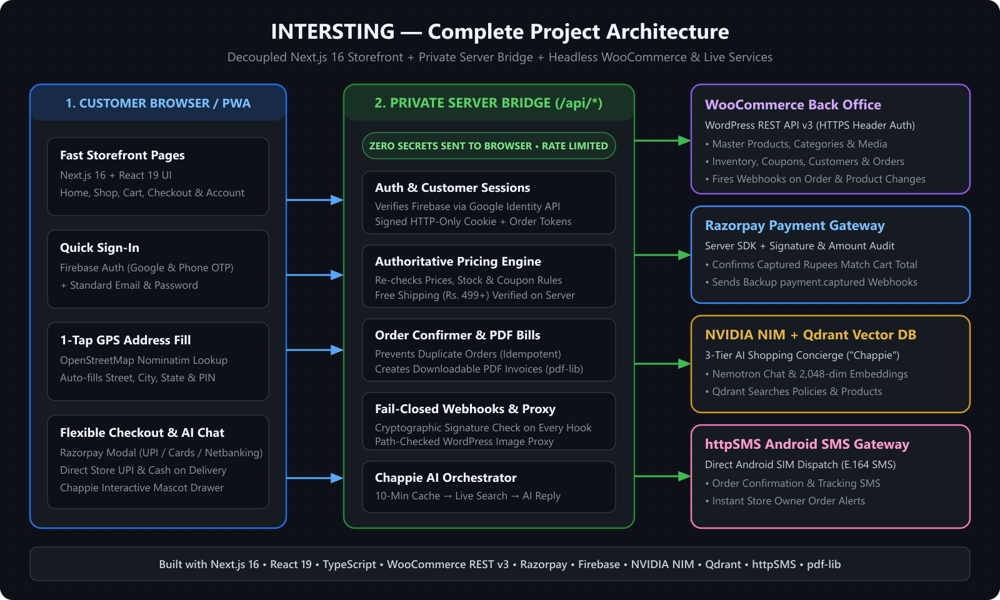

<p align="center">
  
</p>

# 🥜 INTERSTING — Gourmet Dry Fruits Storefront

**INTERSTING** is an online store for gourmet dry fruits, nuts, and pantry staples.

It gives your customers a fast, app-like shopping website on their phone or computer, while letting you manage all products, prices, stock, coupons, and orders from your familiar WordPress and WooCommerce dashboard.

---

## 🌟 What This Store Does (Line by Line)

- **Fast, App-Like Shopping Website:** Customers can browse categories, search for dry fruits, save favorites, and even install the website on their phone home screen like an app.
- **Controlled From WordPress & WooCommerce:** Whenever you add a product, change a price, upload photos, create a coupon, or update an order in WooCommerce, the store stays in sync automatically.
- **Three Easy Ways for Customers to Pay:**
  - **Razorpay Online:** Customers can pay with Google Pay, PhonePe, Paytm, CRED, debit/credit cards, or net banking.
  - **Direct Store UPI:** Customers can pay directly to your store UPI ID with zero gateway fee and enter their 12-digit transaction reference number.
  - **Cash on Delivery:** Customers can confirm their order right away and pay when the delivery arrives.
- **Automatic Price & Stock Check:** Before any payment is accepted, our private server double-checks the real product prices, stock counts, coupon rules, and ₹499 free-shipping rule directly from WooCommerce.
- **One-Tap Address Fill:** At checkout, customers can tap once to fill in their street, city, state, and PIN code automatically using their phone or browser location.
- **Easy Sign-In & PDF Tax Bills:** Shoppers can sign in with Google, mobile phone OTP, or email and password, track their orders, and download clean PDF tax invoices.
- **Chappie AI Shopping Helper:** A friendly built-in chat assistant answers customer questions about products, prices, shipping, and return policies using live store data.
- **Automatic SMS Updates From Your Phone:** Customers receive branded order confirmations and delivery status alerts sent straight from your own Android phone SIM card.

---

## ☁️ Where Everything Is Hosted

Every part of this store has its own clear home. Here is the visual map showing where each piece lives and runs:


### Line-by-Line Hosting Guide

1. **The Customer Website & Private Server Bridge**
   - **Hosted on:** Vercel, a cloud Node.js host, or your own VPS server.
   - **What it does:** Shows the fast storefront pages to shoppers and runs the private server checks for login, pricing, coupons, payments, and PDF invoices.

2. **Your Store Back Office (WordPress + WooCommerce)**
   - **Hosted on:** Your server at `https://intersting.duckdns.org`.
   - **What it does:** Acts as the main control room where you manage products, photos, stock, coupons, customers, and orders.

3. **Chappie AI Memory (Qdrant Vector Database)**
   - **Hosted on:** Your server at `https://intersting.duckdns.org/qdrant`.
   - **What it does:** Stores searchable product details and store policies so Chappie AI can find the right answers in milliseconds.

4. **Online Payments (Razorpay Cloud)**
   - **Hosted on:** Razorpay's secure payment cloud.
   - **What it does:** Collects UPI, card, and net banking payments and sends a backup confirmation signal so no paid order is ever lost.

5. **Customer Sign-In (Google Firebase)**
   - **Hosted on:** Google Firebase Cloud.
   - **What it does:** Powers one-tap Google Sign-In and mobile phone OTP login, then gets verified by our private server.

6. **Chappie AI Brain (NVIDIA NIM)**
   - **Hosted on:** NVIDIA's cloud AI service.
   - **What it does:** Generates helpful, natural replies when shoppers ask questions in the chat box.

7. **Order SMS Alerts (httpSMS + Your Android Phone)**
   - **Hosted on:** The `httpSMS` app on your Android phone (connected through `httpsms.com`).
   - **What it does:** Sends order confirmation and shipping SMS messages using your own SIM card—no expensive per-SMS gateway bills.

8. **One-Tap Location Lookup (OpenStreetMap Nominatim)**
   - **Hosted on:** OpenStreetMap's free public service.
   - **What it does:** Converts a customer's GPS coordinates into a readable street address, city, state, and PIN code at checkout.

---

## 🗺️ How the Whole Store Connects

The diagram below shows how a customer's browser or mobile phone talks to your private server bridge, and how that server safely connects to WooCommerce, Razorpay, Chappie AI, and SMS alerts.



---

## 🛒 How You Control the Store & How Payments Stay Safe

You never have to edit website code for daily store work. Everything flows from your WordPress dashboard to the customer's screen, while the five-step payment check protects every rupee before an order is confirmed.


---

## 🛡️ Built-In Safety & Privacy (Line by Line)

- **Secret Keys Never Leave the Server:** Store passwords, Razorpay secrets, SMS keys, and AI keys stay safely on the server and are never sent to a customer's browser.
- **Protected Customer Accounts:** Login cookies are signed and locked so only the rightful customer can view their saved addresses, order history, or full PDF tax bill.
- **Guest Privacy Protection:** Anyone checking an order without signing in or holding a checkout link only sees basic city, state, and delivery status—never personal phone numbers or street addresses.
- **Backup Payment Confirmation:** Even if a shopper closes the browser or loses internet right after paying on Razorpay, a background confirmation notice still saves their order safely.
- **No Confusing Draft Texts:** Temporary payment holds, drafts, and failed attempts are silently filtered so customers only receive clear, helpful SMS updates.

---

## 🧰 Summary of Tools Used

| Part of the Store | Service / Tool | Hosted Where | What It Handles |
| :--- | :--- | :--- | :--- |
| **Storefront Website** | Next.js & React | Vercel / Node.js VPS | Fast shopping pages, checkout, and installable mobile web app |
| **Store Back Office** | WordPress & WooCommerce | Your Server (`intersting.duckdns.org`) | Products, prices, photos, stock, coupons, and orders |
| **AI Search Memory** | Qdrant | Your Server (`/qdrant`) | Fast product and store policy memory for Chappie AI |
| **AI Chat Brain** | NVIDIA NIM | NVIDIA Cloud | Answers customer questions and recommends products |
| **Online Payments** | Razorpay & Direct UPI | Razorpay Cloud | UPI, cards, net banking, and direct UPI verification |
| **Quick Sign-In** | Google Firebase | Google Cloud | Google Sign-In and mobile phone OTP verification |
| **Order SMS Alerts** | httpSMS | Your Android Phone + `httpsms.com` | Order placed and delivery status texts via your SIM |
| **GPS Address Fill** | OpenStreetMap | OpenStreetMap Public API | One-tap street, city, state, and PIN autofill |
| **PDF Tax Bills** | Built-in PDF Generator | Your Website Server | Downloadable GST-style tax invoices for every order |

---

## 📖 More Guides

- **[Store Owner Handbook](PROJECT_ARCHITECTURE_GUIDE.md)** — A plain-English walkthrough of daily store operations, order flows, and launch checks.

---

<details>
<summary><strong>🛠️ For Developers: Local Setup, Build & Webhook Setup</strong></summary>

<br />

### Requirements

- Node.js 20 or newer
- A running WordPress + WooCommerce store
- Credentials configured in `.env.local` (copy from `.env.example`; never commit `.env.local`)

### Install, Check & Run Locally

```bash
npm install
npx next typegen
npx tsc --noEmit
npx next build
npm run dev
```

Open `http://localhost:3000` in your browser.

### One-Time Webhook Setup

- **Razorpay Dashboard → Settings → Webhooks:** `https://your-domain.com/api/webhooks/razorpay` (events: `payment.captured`, `order.paid`, `payment.failed`)
- **WooCommerce → Settings → Advanced → Webhooks:**
  - Product sync (`product.created`, `product.updated`): `https://your-domain.com/api/webhooks/product`
  - Order SMS (`order.updated`): `https://your-domain.com/api/webhooks/woocommerce/orders`

</details>

---

## 📄 License

Proprietary storefront built for **INTERSTING Gourmet Pantry**. All rights reserved.
