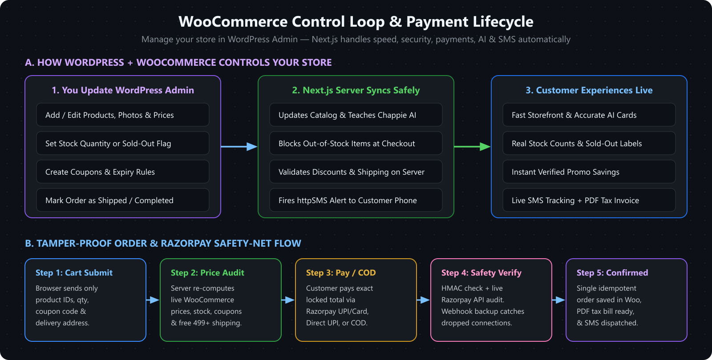

# 🥜 INTERSTING — Gourmet Dry Fruits Storefront

**INTERSTING** is an online store for gourmet dry fruits, nuts, and pantry staples. It combines a fast, app-like shopping website for customers with a familiar WordPress and WooCommerce back office for managing products, prices, stock, and orders—all connected by a private server bridge, online payments, an AI shopping helper, and automatic SMS updates.

---

## 🌟 What This Store Does

- **Fast, Mobile-Friendly Shopping:** Customers can browse categories, search products, save favorites, and install the website on their phone like a mobile app.
- **Managed From WordPress & WooCommerce:** You update product photos, prices, discounts, stock counts, and order statuses in WooCommerce, and the storefront updates automatically.
- **Three Flexible Ways to Pay:**
  - **Razorpay Online:** Customers can pay instantly with Google Pay, PhonePe, Paytm, CRED, cards, or net banking.
  - **Direct Store UPI:** Customers can scan or pay to your store UPI ID and enter their 12-digit transaction reference number.
  - **Cash on Delivery:** Customers can place an order right away and pay when the package arrives.
- **Automatic Price & Stock Protection:** Every order total, coupon discount, stock limit, and ₹499 free-shipping rule is double-checked on the private server against WooCommerce before payment is accepted—so totals can never be tampered with.
- **One-Tap Address Fill:** At checkout, shoppers can tap once to fill in their street, city, state, and PIN code automatically using their device location.
- **Verified Accounts & PDF Tax Bills:** Shoppers can sign in with Google, phone OTP, or email and password, track their orders, and download clean PDF tax invoices.
- **Chappie AI Shopping Assistant:** A built-in store helper answers questions about products, prices, nutrition, shipping, and return policies using live catalog data.
- **Automatic SMS Order Alerts:** Customers receive branded text messages from your Android phone SIM when an order is placed or when its status changes to processing, shipped, completed, cancelled, or refunded.

---

## 🗺️ How the Whole Store Connects

The diagram below shows the three parts of the store working together: what the customer sees on their phone or computer, the private server bridge that checks every rule safely, and the store tools running behind the scenes.


---

## 🛒 How You Control the Store & How Payments Stay Safe

You never have to touch website code to run daily operations. Everything flows from your WordPress dashboard to the customer's screen, while the five-step payment check protects every rupee before an order is confirmed.



---

## 🛡️ Built-In Safety & Privacy

- **Private Keys Stay Hidden:** Store passwords, payment secrets, SMS keys, and AI keys never leave the private server and are never exposed to a customer's browser.
- **Protected Customer Accounts:** Login sessions are signed and locked so only the rightful customer can view their saved addresses, order history, or full PDF tax invoice.
- **Guest Privacy Protection:** Anyone checking an order without signing in or holding a checkout link only sees basic city, state, and delivery status—never personal phone numbers or street addresses.
- **Backup Payment Confirmation:** Even if a customer's internet drops or they close the browser right after paying on Razorpay, a background confirmation notice still records the order safely.
- **Clean Customer Messaging:** Drafts, failed attempts, and temporary holds never trigger confusing SMS messages to shoppers.

---

## 🧰 Tools Powering the Store

| Area | What Is Used | Role in Plain English |
| :--- | :--- | :--- |
| **Website & Mobile App** | Next.js & React | Powers the fast storefront, checkout, and installable phone app experience |
| **Store Back Office** | WordPress & WooCommerce | Where you manage products, inventory, coupons, and orders |
| **Online Payments** | Razorpay & Store UPI | Handles UPI, cards, net banking, and direct UPI order verification |
| **Customer Sign-In** | Google, Phone OTP & Email | Lets shoppers sign in quickly and safely |
| **AI Shopping Helper** | Chappie AI (NVIDIA + Qdrant) | Answers customer questions and recommends products from your catalog |
| **Order SMS Alerts** | Android httpSMS | Sends order confirmations and shipping updates from your Android SIM |
| **Tax Invoices** | Built-in PDF Generator | Creates clean downloadable GST-style tax bills for every order |

---

## 📖 More Guides

- **[Store Owner Handbook](PROJECT_ARCHITECTURE_GUIDE.md)** — A plain-English walkthrough of daily store operations, order flows, and launch checks.

---

<details>
<summary><strong>🛠️ For Developers: Local Setup & Verification</strong></summary>

<br />

### Requirements

- Node.js 20 or newer
- A running WordPress + WooCommerce store
- Credentials configured in `.env.local` (copy from `.env.example`; never commit `.env.local`)

### Install, Check & Run

```bash
npm install
npx next typegen
npx tsc --noEmit
npx next build
npm run dev
```

Open `http://localhost:3000` in your browser.

### Webhook URLs (One-Time Dashboard Setup)

- **Razorpay Dashboard → Settings → Webhooks:** `https://your-domain.com/api/webhooks/razorpay` (events: `payment.captured`, `order.paid`, `payment.failed`)
- **WooCommerce → Settings → Advanced → Webhooks:**
  - Product sync (`product.created`, `product.updated`): `https://your-domain.com/api/webhooks/product`
  - Order SMS (`order.updated`): `https://your-domain.com/api/webhooks/woocommerce/orders`

</details>

---

## 📄 License

Proprietary storefront built for **INTERSTING Gourmet Pantry**. All rights reserved.
