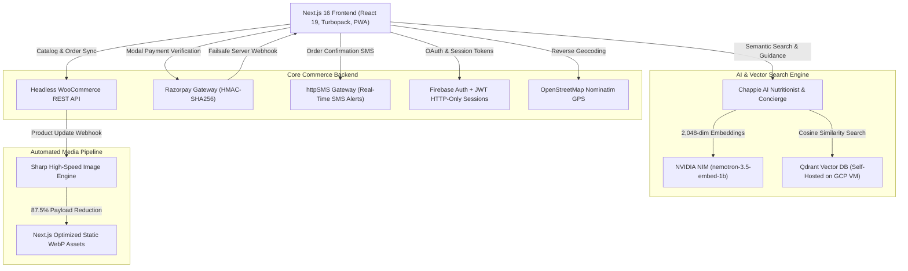

# 🥜 INTERSTING — Gourmet Quick Pantry

> High-performance, full-stack, AI-powered headless e-commerce platform built with **Next.js 16 (React 19 + Turbopack)**, **Headless WooCommerce**, **Razorpay Gateway & Webhooks**, and an **NVIDIA NIM + Qdrant Vector RAG AI Assistant**.

---

## 📑 Table of Contents
- [Architecture Overview](#-architecture-overview)
- [Key Features](#-key-features)
  - [1. Frictionless Checkout & Multi-Channel Payments](#1-frictionless-checkout--multi-channel-payments)
  - [2. AI Shopping Concierge & Vector RAG ("Chappie")](#2-ai-shopping-concierge--vector-rag-chappie)
  - [3. Automated WebP Image Optimization Pipeline](#3-automated-webp-image-optimization-pipeline)
  - [4. Mobile-First UX & PWA Architecture](#4-mobile-first-ux--pwa-architecture)
  - [5. Automated SMS Order Tracking](#5-automated-sms-order-tracking)
- [Project Directory Structure](#-project-directory-structure)
- [Environment Variables Guide](#-environment-variables-guide)
- [Getting Started](#-getting-started)
- [Webhook Configuration](#-webhook-configuration)
- [License](#-license)

---

## 🏛️ Architecture Overview



---

## 🚀 Key Features

### 1. Frictionless Checkout & Multi-Channel Payments
- **Guest Checkout (Zero-Password Friction)**: Customers can place orders in under 60 seconds without creating an account or entering passwords.
- **1-Tap GPS Auto-Fill**: Automatically resolves building, road, city, and 6-digit PIN code via OpenStreetMap Nominatim reverse geocoding.
- **Razorpay Online Payments**: Full support for UPI (Google Pay, PhonePe, Paytm, CRED), Debit/Credit Cards, and 50+ Netbanking banks.
- **Cryptographic Security**: HMAC-SHA256 signature verification guarantees 100% protection against price tampering and spoofed payments.
- **Razorpay Webhook Safety Net (`/api/webhooks/razorpay`)**: If a customer's internet cuts out or phone battery dies right after entering their UPI PIN, Razorpay calls our background webhook server-to-server to automatically confirm the order in WooCommerce.
- **Pay on Delivery (COD) & Direct UPI**: Instant COD order processing and manual UPI transfer with 12-digit UTR confirmation.

### 2. AI Shopping Concierge & Vector RAG ("Chappie")
- **Semantic RAG Pipeline**: Ingests store policies (Returns, Shipping, FAQ, Purity Standards) and catalog inventory into a self-hosted **Qdrant Vector Database** on a Google Cloud VM.
- **2,048-Dimension Embeddings**: Powered by **NVIDIA NIM (`nvidia/nemotron-3.5-embed-1b`)** for sub-second semantic retrieval.
- **Interactive UI with Mobile Keyboard Adaptation**:
  - Automatically respects the mobile virtual keyboard using `window.visualViewport` and Next.js `interactiveWidget: 'resizes-content'`.
  - Background body scrolling is locked while chat is active.
  - Auto-scrolls messages so conversation history and latest answers stay visible right above the input bar.
  - Direct 1-tap product recommendation cards with animated "Add to Cart" badges.

### 3. Automated WebP Image Optimization Pipeline
- **87.5% Payload Slashed**: Converted high-res catalog images (16.8 MB down to 2.1 MB) into modern WebP format using `sharp`.
- **Local Serving**: Images are served directly from the local Next.js server with `Cache-Control: public, max-age=31536000, immutable`, eliminating round-trip latency to WordPress.
- **Automated Webhook Sync (`/api/webhooks/product`)**: When an admin uploads a new photo or edits a product in WordPress, WooCommerce triggers our webhook to download, compress, and update the local `.webp` asset automatically.

### 4. Mobile-First UX & PWA Architecture
- **Progressive Web App (PWA)**: Full manifest, offline readiness, and custom circular squirrel badge favicon.
- **Adaptive Mobile App Capsule**: Floating navigation bar that smoothly docks or glides down based on scroll direction.
- **Micro-Animations**: Particle fly-to-cart animations, floating cart bar, and responsive Zepto-style category explorer.

### 5. Automated SMS Order Tracking
- **httpSMS Gateway Integration**: Real-time branded SMS dispatch to customers immediately upon order confirmation with live delivery tracking links.
- **Admin Alerts**: Instant notifications sent to store management upon high-value or new order placement.

---

## 📁 Project Directory Structure

```text
intersting-app/
├── app/                              # Next.js 16 App Router
│   ├── account/                      # Customer profile, saved addresses & order history
│   ├── api/                          # Serverless & edge API endpoints
│   │   ├── assistant/                # NVIDIA NIM + Qdrant RAG chat endpoint
│   │   ├── auth/                     # Firebase Auth, Google OAuth & JWT sessions
│   │   ├── coupons/                  # Live WooCommerce coupon validation
│   │   ├── media/                    # Authenticated/validated WordPress media redirect proxy
│   │   ├── orders/                   # Order creation & status queries
│   │   ├── payment/                  # Razorpay order creation & signature verification
│   │   └── webhooks/                 # Automated Webhook Listeners
│   │       ├── product/              # Auto-sync product images & vector embeddings
│   │       ├── razorpay/             # Safety-net background payment confirmation
│   │       └── woocommerce/orders/   # Status updates & SMS triggers
│   ├── cart/                         # Cart review & delivery calculations
│   ├── checkout/                     # 3-step checkout (Guest, Address, Payment)
│   ├── product/[slug]/               # Dynamic product details with rich nutrition
│   ├── shop/                         # Full catalog with search, filter & sorting
│   └── layout.tsx                    # Root layout with responsive viewport & providers
├── components/                       # Modular UI components
│   ├── cart/                         # Slide-out drawer & floating cart pill
│   ├── chat/                         # Chappie AI Assistant widget & mobile keyboard sync
│   ├── home/                         # Bento grids, story sections & category explorer
│   ├── layout/                       # Header, announcement bar, mobile capsule & footer
│   └── product/                      # Product cards, review lists & trust badges
├── content/policies/                 # Markdown & JSON single-source-of-truth policies
├── lib/                              # Core utilities & SDK wrappers
│   ├── api/                          # WooCommerce REST API client & helpers
│   ├── auth/                         # Iron session & Firebase token verification
│   ├── payment/                      # Razorpay SDK, webhook verification & idempotency
│   ├── rag/                          # Qdrant vector client & catalog search
│   └── sms/                          # httpSMS dispatch helper
├── public/images/products/           # High-efficiency pre-optimized local WebP images
├── scripts/                          # Build & maintenance utilities
│   ├── optimize-products.mjs         # Sharp WebP batch compression tool
│   └── sync-policies.mjs             # Ingests policy JSONs to Qdrant during build
└── types/                            # TypeScript interfaces for products, orders & cart
```

---

## 🔑 Environment Variables Guide

Create a `.env.local` file in the root of `intersting-app`:

```env
# ─── WooCommerce Headless Backend ─────────────────────────────────────────────
NEXT_PUBLIC_WC_URL=https://intersting.duckdns.org
WC_CONSUMER_KEY=ck_xxxxxxxxxxxxxxxxxxxxxxxxxxxxxxxxxxxxxxxx
WC_CONSUMER_SECRET=cs_xxxxxxxxxxxxxxxxxxxxxxxxxxxxxxxxxxxxxxxx
WC_APP_USER=your_wp_username
WC_APP_PASSWORD=xxxx xxxx xxxx xxxx xxxx xxxx

# ─── Razorpay Payment Gateway ──────────────────────────────────────────────────
NEXT_PUBLIC_RAZORPAY_KEY_ID=rzp_test_xxxxxxxxxxxxxx
RAZORPAY_KEY_SECRET=xxxxxxxxxxxxxxxxxxxxxxxx
RAZORPAY_WEBHOOK_SECRET=your_custom_webhook_secret_here

# ─── Store UPI Configuration ───────────────────────────────────────────────────
NEXT_PUBLIC_STORE_UPI_ID=your_upi_id@upi
NEXT_PUBLIC_STORE_UPI_NAME=INTERSTING

# ─── Qdrant Vector Database (Self-Hosted on GCP VM) ───────────────────────────
QDRANT_URL=https://intersting.duckdns.org/qdrant
QDRANT_COLLECTION=products_rag

# ─── NVIDIA NIM AI Embeddings & Chat ──────────────────────────────────────────
NVIDIA_API_KEY=nvapi-xxxxxxxxxxxxxxxxxxxxxxxxxxxxxxxx
NVIDIA_EMBED_URL=https://integrate.api.nvidia.com/v1/embeddings
NVIDIA_EMBED_MODEL=nvidia/nemotron-3.5-embed-1b

# ─── httpSMS Mobile Notifications ──────────────────────────────────────────────
HTTPSMS_API_KEY=your_httpsms_api_key_here
HTTPSMS_FROM_PHONE=+919876543210
HTTPSMS_ENABLED=true

# ─── Firebase Auth (Optional Google / Passwordless login) ──────────────────────
NEXT_PUBLIC_FIREBASE_API_KEY=AIzaxxxxxxxxxxxxxxxxxxxxx
NEXT_PUBLIC_FIREBASE_AUTH_DOMAIN=interesting.firebaseapp.com
NEXT_PUBLIC_FIREBASE_PROJECT_ID=interesting-xxxxx
```

---

## 💻 Getting Started

### 1. Install Dependencies
```bash
npm install
```

### 2. Run the Development Server
```bash
npm run dev
```
Open [http://localhost:3000](http://localhost:3000) in your browser.

### 3. Build & Test Production Bundle
```bash
npm run build
npm run start
```
The build automatically compiles static routes with Turbopack and syncs all markdown policies to the Qdrant vector database via NVIDIA NIM embeddings.

---

## 🔗 Webhook Configuration

### 1. Razorpay Webhook (Safety Net)
1. Go to **Razorpay Dashboard $\rightarrow$ Settings $\rightarrow$ Webhooks $\rightarrow$ Add New Webhook**.
2. **Webhook URL**: `https://your-domain.com/api/webhooks/razorpay`
3. **Secret**: Enter the value configured in `RAZORPAY_WEBHOOK_SECRET`.
4. **Active Events**: Check `payment.captured`, `order.paid`, and `payment.failed`.

### 2. WooCommerce Webhooks (Product & Order Sync)
1. In WordPress Admin, navigate to **WooCommerce $\rightarrow$ Settings $\rightarrow$ Advanced $\rightarrow$ Webhooks**.
2. **Product Sync**:
   - **Topic**: `Product updated` & `Product created`
   - **Delivery URL**: `https://your-domain.com/api/webhooks/product`
   - **Secret**: Set in `WC_WEBHOOK_SECRET`.
3. **Order Status Sync**:
   - **Topic**: `Order updated`
   - **Delivery URL**: `https://your-domain.com/api/webhooks/woocommerce/orders`
   - **Secret**: Set in `WC_WEBHOOK_SECRET`.

---

## 📄 License
This project is proprietary and built for **INTERSTING Gourmet Quick Pantry**. All rights reserved.
