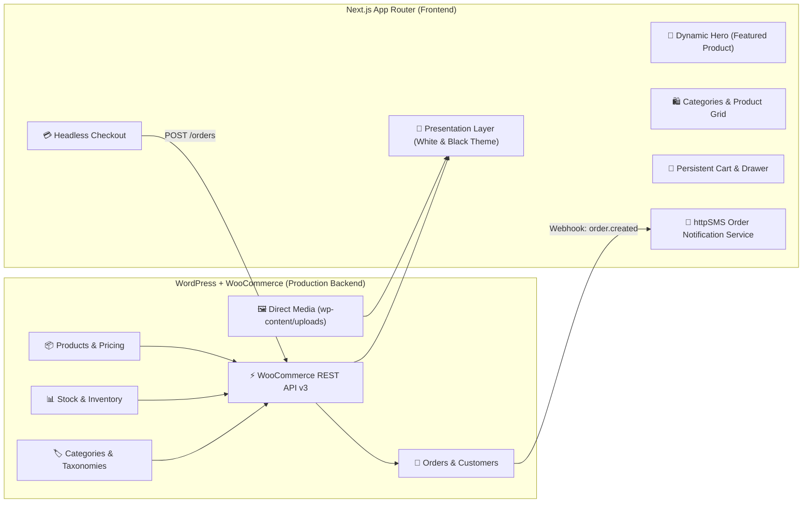

# INTERSTING — Headless WooCommerce & Next.js Production Architecture Guide

> **Core Philosophy:** **99% of all business logic resides strictly inside WordPress & WooCommerce.**  
> The Next.js frontend is a pure, lightning-fast presentation and shopping layer. Whatever you add, update, or remove in your WordPress Admin (`https://intersting.duckdns.org/wp-admin`) instantly drives the live website.

---

## 1. System Architecture Overview



---

## 2. Production Backend Details

- **Store Backend Domain:** `https://intersting.duckdns.org`
- **WordPress Admin:** `https://intersting.duckdns.org/wp-admin`
- **WooCommerce REST Endpoint:** `https://intersting.duckdns.org/wp-json/wc/v3`
- **Authentication:** Standard WooCommerce Basic Auth using `WC_CONSUMER_KEY` and `WC_CONSUMER_SECRET` over HTTPS (or WordPress Application Password).
- **Direct Media Delivery:** High-resolution product images and category thumbnails are served directly from `https://intersting.duckdns.org/wp-content/uploads/...` with Next.js image optimization, eliminating serverless proxy bottlenecks.

---

## 3. Managing Your Store in WordPress

Every aspect of your e-commerce store is controlled directly from your WordPress dashboard:

### 3.1 Products & Pricing
- **Add / Edit / Delete Products:**  
  Go to **WordPress Admin → Products → All Products / Add New**.
- **Regular & Sale Price:**  
  Set the **Regular price** and **Sale price** in the Product Data box. If a sale price is set, Next.js automatically calculates and displays the exact percentage discount badge (e.g., `15% OFF`).
- **Product Descriptions:**  
  - **Main Description:** Shows on the dedicated product detail page (`/product/[slug]`).
  - **Short Description:** Displays on the product cards and summary snippets.
- **Product Images & Gallery:**  
  Upload the **Product image** and **Product gallery** in the right sidebar. Next.js pulls and optimizes these images directly from `intersting.duckdns.org`.

### 3.2 Featured Products (Hero Banner)
- In **Products → All Products**, click the **Star (★)** icon next to any product to mark it as **Featured**.
- The Next.js homepage Hero Banner dynamically showcases that featured product (title, badge, pricing, image, and direct link).

### 3.3 Categories
- Go to **Products → Categories**.
- Any category you create (e.g., *Nuts & Kaju, Super Seeds, Dry Fruits*) appears automatically in the top navigation category bar and explorer.
- Upload a thumbnail image for the category in WordPress to customize its circular navigation icon.

### 3.4 Stock & Inventory Management
- In product settings, under **Inventory**:
  - Set **Stock status** to *In stock* or *Out of stock*.
  - When set to *Out of stock*, the Next.js add-to-cart button automatically changes to **"Sold Out"** and disables ordering.
  - Enable **Manage stock** to track exact inventory quantities.

### 3.5 Customer Orders
- When a customer checks out on the Next.js site, the frontend issues an authenticated `POST /wp-json/wc/v3/orders` request to WooCommerce.
- The order instantly appears in **WooCommerce → Orders** with:
  - Customer billing & shipping address
  - Line items, quantities, and line totals
  - Payment method (Cash on Delivery / UPI)
  - Order status set to `processing` or `pending`

---

## 4. Themes: Full White & Black Theme

The storefront features an ultra-clean minimalist monochrome design system supporting both **Full White Theme** and **Black Theme**:

| Element | Full White Theme (Default) | Black Theme (Dark Mode) |
|---|---|---|
| **Background** | Crisp Pure White (`#ffffff`) | Deep Black (`#000000`) |
| **Surface Cards** | White with subtle neutral border (`#e5e7eb`) | Charcoal Black (`#0c0c0e`) with border (`#27272a`) |
| **Typography** | Deep Charcoal (`#111827`) & Slate (`#4b5563`) | Bright White (`#f4f4f5`) & Zinc (`#a1a1aa`) |
| **Primary Buttons** | Contrast Solid Black with White text | Contrast Solid White with Black text |
| **Toggle** | One-click button in Header (☀️ / 🌙) | Remembers choice in `localStorage` |

---

## 5. Customer Authentication & Google OAuth

- **Google OAuth:** Users click "Continue with Google" → Next.js verifies the Google profile → automatically searches or registers the customer in WooCommerce (`POST /wp-json/wc/v3/customers`) → creates a secure HTTP-only session cookie.
- **Email / Password:** Users can register and log in with standard credentials.
- **Forgot Password:** Users enter their registered email at `/forgot-password` to trigger password reset instructions verified with WooCommerce.
- **Checkout Pre-Fill:** Logged-in customers have their name, email, phone, and saved shipping address auto-filled at checkout, and the order is linked directly to their WooCommerce customer ID.

### Setting Up Google Sign-In (Firebase):
> **Note:** Google Sign-In is now handled via **Firebase Authentication** (project `ngl-1b75b`). No separate Google Cloud OAuth credentials are needed in Next.js.
1. Go to [Firebase Console](https://console.firebase.google.com/project/ngl-1b75b).
2. Navigate to **Authentication → Sign-in method**.
3. Click **Google → Enable → Save**.
4. Go to **Authentication → Settings → Authorized domains** and add:
   - `intersting.duckdns.org`
   - Your Vercel deployment domain (e.g. `*.vercel.app`)
5. Add `NEXT_PUBLIC_FIREBASE_*` variables to your environment (see `.env.example`).

---

## 6. Automated SMS Notifications (httpSMS Gateway)

Instant customer SMS alerts are dispatched when orders are placed or updated:
- **Order Confirmation:** Sent to customer upon successful checkout.
- **Admin Alert:** Instant notification to store owner for new orders.
- **Status Updates:** Triggered when order status changes to *Completed*, *Shipped*, or *Cancelled* via WooCommerce Webhooks.

---

## 7. Production Environment Configuration

In your production hosting environment (e.g. Vercel), set the following environment variables:

```env
# WooCommerce Production Backend URL
NEXT_PUBLIC_WC_URL=https://intersting.duckdns.org

# Production site URL (used in SMS tracking links)
NEXT_PUBLIC_SITE_URL=https://intersting.duckdns.org

# WooCommerce REST API Credentials
WC_CONSUMER_KEY=ck_...
WC_CONSUMER_SECRET=cs_...

# WordPress Application Password
WC_APP_USER=your_wordpress_username
WC_APP_PASSWORD=your app password here

# Secret key for customer session cookies
SESSION_SECRET=your-random-secret-key

# Firebase Authentication (project: ngl-1b75b)
NEXT_PUBLIC_FIREBASE_API_KEY=...
NEXT_PUBLIC_FIREBASE_AUTH_DOMAIN=ngl-1b75b.firebaseapp.com
NEXT_PUBLIC_FIREBASE_PROJECT_ID=ngl-1b75b
NEXT_PUBLIC_FIREBASE_STORAGE_BUCKET=ngl-1b75b.firebasestorage.app
NEXT_PUBLIC_FIREBASE_MESSAGING_SENDER_ID=...
NEXT_PUBLIC_FIREBASE_APP_ID=...
NEXT_PUBLIC_FIREBASE_MEASUREMENT_ID=...

# httpSMS Gateway
HTTPSMS_API_KEY=...
HTTPSMS_FROM_PHONE=+91XXXXXXXXXX
HTTPSMS_ADMIN_PHONE=+91XXXXXXXXXX
DEFAULT_PHONE_COUNTRY_CODE=+91
HTTPSMS_ENABLED=true

# WooCommerce Webhook Secret
WC_WEBHOOK_SECRET=your_webhook_secret_here
```

---

## 8. WooCommerce Webhook Configuration

To receive automatic order status and dispatch updates from WooCommerce:
1. Open **WordPress Admin → WooCommerce → Settings → Advanced → Webhooks**.
2. Click **Add Webhook**:
   - **Name:** Next.js Order Webhook
   - **Status:** Active
   - **Topic:** Order updated (and create another for Order created)
   - **Delivery URL:** `https://intersting.duckdns.org/api/webhooks/woocommerce/orders`
   - **Secret:** Copy the value of `WC_WEBHOOK_SECRET`
   - **API Version:** WP REST API Integration v3
3. Save the webhook.
